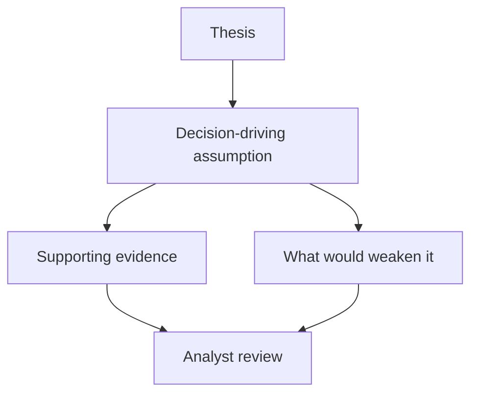

# Review a research handoff

[Project overview](README.md) · [Handoff example](review_packet.py)

## Put the assumption next to the claim

The research library collects company material. The analyst workflow shows work in progress, while valuation and review give an analyst a place to connect assumptions to the recommendation. I built the hub and prepared the technical documentation and tutorial for its handoff.

A useful review starts with the assumption most likely to change the recommendation. In the fictional example, secured offtake is the reason to prioritize a project for diligence. The reviewer still needs the terms that support the assumption and a question about whether the protection would survive a counterparty default.

The [executable example](review_packet.py) checks for those pieces before human review. A complete packet can still contain weak evidence. The reviewer assesses the evidence and decides whether the recommendation follows.

## Keep access separate from review state

A draft can be ready for review and still belong to a restricted group. The browser presents the workflow, while the data layer has to decide whether the caller may read or update the record. Hiding a control in the browser leaves the underlying permission question open.

The original handoff included database scripts and tests. The public sample covers packet completeness using invented records. It has no account connection and makes no claim about current deployed permissions. [Publication scope](PUBLICATION.md)
