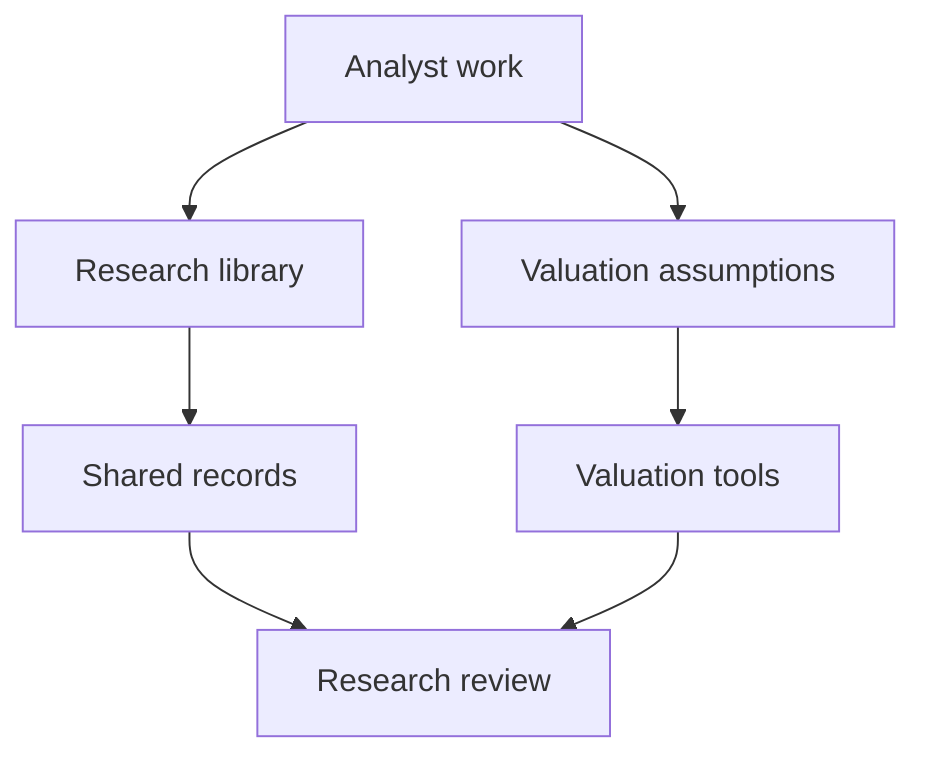

# AINU Research Hub

A shared workspace that connects company research, analyst work, valuation tools, and review.

[Read the case study](CASE_STUDY.md) · [Workflow](#workflow) · [Publication scope](PUBLICATION.md)

## Make the research reviewable

Research becomes difficult to hand off when company notes, assignments, supporting documents, and valuation assumptions are scattered across separate locations.

AINU Research Hub brings those responsibilities into a common workflow. The aim is to make a research argument easier to follow and an analyst handoff easier to review.

## Workflow

The diagram connects the research responsibilities described by the project. It does not imply a particular approval state or a verified live deployment.

## Architecture

| Area | Responsibility |
| --- | --- |
| Browser interface | Present research material and analyst work |
| Research library | Organize company notes and supporting documents |
| Valuation tools | Connect assumptions with an investment argument |
| Database layer | Store shared records and define access behavior |
| Review tools | Support consistent analyst handoffs |

The private source includes database scripts and checks for application behavior and access boundaries.

## Design decisions

**Keep assumptions visible.** A valuation result is easier to discuss when a reviewer can identify the assumptions behind it.

**Separate research from account configuration.** Research content and the settings that control access serve different purposes and need different handling.

**Review access behavior directly.** A screen that looks restricted does not establish that the underlying data is restricted. The database behavior needs its own verification.

The [case study](CASE_STUDY.md) explains how these responsibilities fit together and what remains outside the public evidence.

## Scope and contribution

This publication documents the workflow and architecture. Source code, analyst records, financial examples, account settings, contacts, attachments, and development history remain private.

AI assisted with implementation, checks, and documentation. This writeup does not establish the current security of the deployed database or confirm a working live integration. [Publication policy](PUBLICATION.md)
